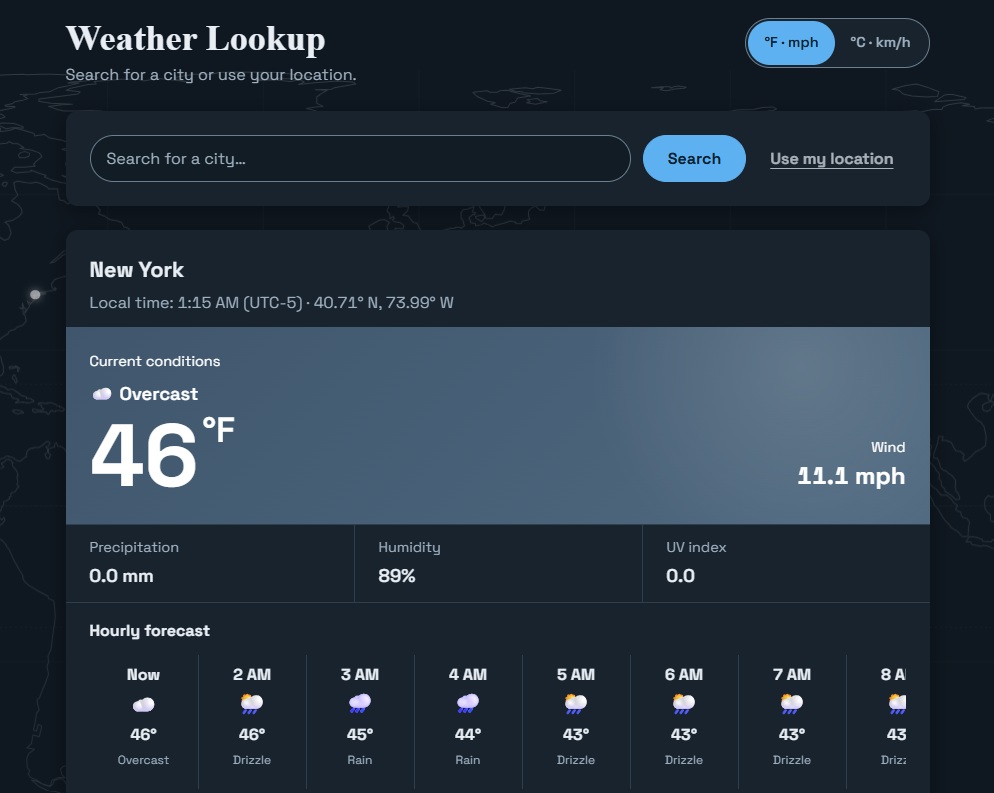

# Weather Lookup

An easy-to-use weather dashboard for checking current conditions and the next
twelve hours for any city or your current location.

**Live demo: <https://docker-weather-test.vercel.app/>**

- Starts with an approximate location from your IP address (no permission
  prompt), or search for any city.
- See temperature, wind, precipitation, humidity, UV index, and an hourly
  forecast.
- Switch between °F/mph and °C/km/h; your choice is remembered in the browser.
- Runs locally with Python or Docker. No account or API key is required.


*The dashboard (New York shown).*

## Try it in two minutes

```bash
docker build -t weather-lookup .
docker run --rm -p 5000:5000 weather-lookup
```

Open **<http://localhost:5000>** in your browser. For the Python option and
other ways to run the project, see [Quick start](#quick-start).

## Contents

- [Quick start](#quick-start)
- [Using the dashboard](#using-the-dashboard)
- [How it works](#how-it-works)
- [API reference](#api-reference)
- [Configuration](#configuration)
- [Troubleshooting](#troubleshooting)
- [Development](#development)
- [Deploying](#deploying)
- [Data sources and credits](#data-sources-and-credits)

## Quick start

You need either Docker, or Python 3.13 (the version the tests and the Docker
image use). Either way you are looking at the dashboard in about two minutes.

### Option 1: Docker

```bash
docker build -t weather-lookup .
docker run --rm -p 5000:5000 weather-lookup
```

### Option 2: Python

macOS or Linux:

```bash
python3 -m venv .venv
source .venv/bin/activate
pip install -r requirements.txt
python -m app.weather_app
```

Windows (PowerShell):

```powershell
python -m venv .venv
.\.venv\Scripts\Activate.ps1
pip install -r requirements.txt
python -m app.weather_app
```

### Open it

Go to **<http://localhost:5000>** in your browser. Use `http://`, not
`https://`: the app does not serve TLS (see [Troubleshooting](#troubleshooting)).

To check that the server itself is up without a browser:

```bash
curl http://localhost:5000/healthz
# {"status":"ok"}
```

The server needs internet access, because the weather, city search and place
names come from public services (see [Data sources](#data-sources-and-credits)).

## Using the dashboard

| You want to | Do this |
| --- | --- |
| See the weather where you are | The page starts with an approximate spot based on your network. For a precise one, click **Use my location** next to the search box and allow the browser's prompt. |
| See the weather somewhere else | Type a city in the search box and press **Search**, or pick a suggestion. Arrow keys move through suggestions, **Enter** picks one, **Esc** closes the list. |
| Switch units | Use the **°F · mph** / **°C · km/h** toggle. Your choice is remembered in this browser. |
| Stop the moving background | Turn off **Animate background** at the bottom of the page. It is also off automatically if your system asks for reduced motion. |

The page never asks for location permission by itself. When it opens, the
server quietly estimates where you are from your IP address, so weather appears
straight away with no extra prompts or messages. The estimate is usually
accurate to the city or region and can be wrong (VPNs and mobile networks often
are). If it is not available, the dashboard shows **New York**.

The browser's permission prompt appears only after you click **Use my
location**. If you deny it, the dashboard keeps showing the current place and
explains why. After a successful lookup, the coordinates and resolved name are
cached in this browser for 15 minutes as `user-location`; later uses and
refreshes reuse that client-side location without asking again.

Search results are ranked using what you typed, how close each place is to the
place you are viewing, how large it is, and the places you picked before. Your
recent picks are stored only in your browser.

### What the numbers mean

- **Temperature and wind** are current readings for the chosen coordinates.
- **Precipitation** is rain falling now, in millimetres.
- **Humidity** is relative humidity, as a percentage.
- **UV index** is the current ultraviolet index (0 is none, 11 and above is extreme).
- **Checked** is the time your browser last fetched the data, not the time the
  weather station measured it. The server caches results for 30 seconds.
- **Hourly forecast** shows the next twelve hours, starting with **Now**.

## How it works

```text
Browser (public/static/ + app/templates/)
   |
   |  GET /location         approximate position from the visitor's IP
   |  GET /search           find a city by name
   |  GET /weather          current conditions + hourly forecast
   |  GET /reverse-location turn browser coordinates into a place name
   v
Flask app (app/weather_app.py)  --  validates input, caches, rate limits
   |
   |--> Open-Meteo forecast   weather
   |--> Open-Meteo geocoding  city search
   |--> OpenStreetMap Nominatim   place name for browser coordinates
   v
JSON validated by app/api_contracts.py, then returned to the browser
```

The app is stateless and stores no weather data. Responses from the providers
are checked against a strict shape before they are passed on; if a provider
returns something unexpected, the app answers `502` instead of passing it
through.

## API reference

The dashboard uses these endpoints, and you can call them directly. All
responses are JSON. Errors look like `{"error": "message"}`.

### `GET /weather`

Current conditions and the next hours of forecast for a point.

| Parameter | Type | Required | Range |
| --- | --- | --- | --- |
| `latitude` | number | yes | -90 to 90 |
| `longitude` | number | yes | -180 to 180 |

```bash
curl "http://localhost:5000/weather?latitude=40.71&longitude=-74.01"
```

```json
{
  "latitude": 40.71,
  "longitude": -74.01,
  "current": {
    "temperature_2m": 64.0,
    "wind_speed_10m": 8.4,
    "weather_code": 2,
    "rain": 0.0,
    "relative_humidity_2m": 58,
    "uv_index": 2.6
  },
  "hourly": {
    "time": ["2026-11-12T13:00", "2026-11-12T14:00"],
    "temperature_2m": [64.0, 64.0],
    "weather_code": [2, 2]
  },
  "source": "Open-Meteo"
}
```

- Units follow the server configuration. The defaults are °F and mph; rain is
  in millimetres.
- `weather_code` is a [WMO weather code](https://open-meteo.com/en/docs#weathervariables).
  The dashboard turns it into a label such as *Clear*, *Rain* or *Thunderstorm*.
- `hourly` holds up to 48 hours so the dashboard can show 12 consecutive
  hours even when the forecast crosses midnight.

### `GET /search`

Finds places by name. Returns up to 10 matches.

| Parameter | Type | Required | Notes |
| --- | --- | --- | --- |
| `q` | string | yes | At least one character. |
| `latitude`, `longitude` | number | no | Rank nearby places higher. Send both or neither. Defaults to New York. |
| `affinity` | string | no | Comma-separated names to favour, such as recent picks (first 10 are used). |

```bash
curl "http://localhost:5000/search?q=paris"
```

```json
{
  "results": [
    {
      "name": "Paris",
      "context": "Ile-de-France, France",
      "latitude": 48.85341,
      "longitude": 2.3488,
      "population": 2138551
    }
  ]
}
```

Results are ordered by a weighted score: 55% how well the name matches, 15%
proximity, 20% population and 10% affinity. They are cached for five minutes.

### `GET /reverse-location`

Turns coordinates into a place name. Takes `latitude` and `longitude`, and
returns `{"name": "New York, New York, United States"}`. If the lookup fails the
dashboard still shows the weather, labelled **Your location**.

### `GET /location`

Estimates the caller's coordinates from their IP address. Returns `latitude`,
`longitude`, `name` and `source`. The dashboard calls this when it opens. The
caller's public address is sent to the IP location provider (see
[Data sources](#data-sources-and-credits)) and results are cached in memory for
an hour per address. Local and private addresses (such as `127.0.0.1`) cannot
be located and return `404`. IP-based locations are approximate.

### `GET /healthz` and `GET /readyz`

Return `{"status": "ok"}` and `{"status": "ready"}`. Neither calls an external
service, so a provider outage never makes a health check fail. The Docker image
uses `/healthz` for its health check.

### Errors

| Status | Meaning |
| --- | --- |
| `400` | A missing, non-numeric or out-of-range parameter. |
| `429` | Too many requests from one client. The `Retry-After` header says how many seconds to wait. |
| `502` | A weather, search or location provider failed or returned an unexpected response. |

Every response carries an `X-Request-ID` header. Send your own to trace a
request through the logs.

## Configuration

Set environment variables before starting the app. All are optional.

| Variable | Default | What it does |
| --- | --- | --- |
| `PORT` | `5000` | Port for `python -m app.weather_app` only. The Docker image always listens on 5000. |
| `TEMPERATURE_UNIT` | `fahrenheit` | `fahrenheit` or `celsius`. See the note below. |
| `WIND_SPEED_UNIT` | `mph` | `mph`, `kmh` or `ms`. See the note below. |
| `WEATHER_CACHE_TTL` | `30` | Seconds to cache a weather result. |
| `WEATHER_CACHE_SIZE` | `256` | Most locations kept in the weather cache. |
| `SEARCH_CACHE_TTL` | `300` | Seconds to cache search results. |
| `UPSTREAM_TIMEOUT` | `5` | Seconds to wait for a provider. |
| `RATE_LIMIT` | `60` | Requests allowed per client in each window. |
| `RATE_WINDOW` | `60` | Length of the rate-limit window, in seconds. |
| `TRUST_VERCEL_CLIENT_IP` | `true` on Vercel, otherwise `false` | Identify visitors by Vercel's `X-Vercel-Forwarded-For` header when rate limiting. Leave it off anywhere else: a client could forge the header. |
| `ASSET_VERSION` | hash of `public/static` | Label added to asset URLs (`?v=`) to refresh browser caches. Set it only to force a refresh. |
| `OPEN_METEO_URL` | Open-Meteo forecast | Weather provider URL. |
| `GEOCODING_URL` | Open-Meteo geocoding | City search provider URL. |
| `REVERSE_GEOCODING_URL` | Nominatim | Place-name provider URL. |
| `IP_LOCATION_URL` | `https://ipapi.co/{ip}/json/` | IP location provider URL. `{ip}` is replaced with the visitor's public address. A URL without `{ip}` is used as it is. |

Static dashboard assets are served with a one-day browser cache and
`immutable` caching. Their URLs include a version taken from the files'
contents, so browsers fetch new assets as soon as one changes and keep reusing
them otherwise, including across restarts and serverless cold starts.

> **Keep the unit defaults if you use the dashboard.** The page expects °F and
> mph from the API and does the metric conversion itself. If you set
> `TEMPERATURE_UNIT=celsius` or `WIND_SPEED_UNIT=kmh`, the dashboard will show
> wrong numbers. These settings are for people who call the API directly.

Example:

```bash
# macOS or Linux
PORT=8000 RATE_LIMIT=120 python -m app.weather_app
```

```powershell
# Windows (PowerShell)
$env:PORT = "8000"
$env:RATE_LIMIT = "120"
python -m app.weather_app
```

The server also sends `X-Content-Type-Options`, `X-Frame-Options`,
`Referrer-Policy` and `Content-Security-Policy` headers, and logs one line per request (method, path, status,
duration and request ID) without logging provider responses.

## Troubleshooting

**The browser says "Bad request version" or the connection fails on `https://`.**
Port 5000 is plain HTTP. Use `http://localhost:5000`. To serve HTTPS, put a
reverse proxy in front.

**"Address already in use" on startup.** Something else is using port 5000
(AirPlay Receiver on macOS is a common one). Start the app on another port:
`PORT=8000 python -m app.weather_app`, or `docker run -p 8000:5000 weather-lookup`.

**The page shows New York, or the wrong city, when it opens.** The page starts
from a silent IP-based estimate. New York means the estimate was unavailable (you are
on a local or private address such as `localhost`, or the provider is rate
limited). A wrong city is normal for VPNs and mobile networks. Press **Use my
location** and allow the browser prompt for a precise position. If you denied
it earlier, allow location for the site in your browser settings first. Location needs a secure context: `http://localhost` works, but a
plain-HTTP address on another machine does not.

**"Weather service unavailable" (`502`).** The server could not reach the
provider, or got an unexpected reply. Check the server's internet access and
read its log; then press **Try again**.

**"Too many requests" (`429`).** One client sent more than `RATE_LIMIT`
requests in `RATE_WINDOW` seconds. Wait the number of seconds shown, or raise
the limit.

**Temperatures look wrong.** Check that `TEMPERATURE_UNIT` and
`WIND_SPEED_UNIT` are not set (see [Configuration](#configuration)).

**The page is unstyled or blank.** The CSS and JavaScript load from `/static`.
If you build your own image, make sure it copies the `public` folder (the Dockerfile does).

## Development

### Project layout

```text
app/
  weather_app.py           Flask app: routes, caching, rate limiting
  api_contracts.py         Validation of provider responses and API shapes
  templates/
    weather_dashboard.html Page markup
public/static/             Served at /static (by Vercel's CDN, or by Flask locally)
  css/dashboard.css        Styles and design tokens
  js/dashboard.js          Page logic
  js/search-box.js         Accessible city search (ARIA combobox)
  js/format.js             Units, weather-code labels, number formatting
  js/storage.js            Safe localStorage wrapper
  img/world-map.svg        Background map (generated, see below)
  fonts/                   Space Grotesk (self-hosted) and its licence
vercel.json                Vercel function and static-file cache settings
pyproject.toml             Python version, dependencies and Vercel entrypoint
scripts/
  build-world-map.mjs      Generates the map from Natural Earth data
tests/test_app.py         Test suite
docs/                     Screenshot, design handoff spec, design system
```

### Run the tests

```bash
pip install -r requirements-dev.txt
python -m pytest
```

The tests cover every endpoint, input validation, provider failures, caching,
rate limiting, security headers, the page and its static files. They use mocked providers, so
they run offline. GitHub Actions runs them on every push and pull request.

### Change the background map

`public/static/img/world-map.svg` is an outline of real coastlines (Natural Earth
1:110m data, equirectangular projection, 84°N to 58°S) that scrolls slowly
behind the page. It is generated, not drawn. To rebuild it:

```bash
cd scripts
npm install
npm run build-map
```

### Design notes

- [`docs/design-handoff.md`](docs/design-handoff.md) describes the layout,
  states, keyboard behaviour and accessibility requirements for the dashboard.
- [`docs/design-system.md`](docs/design-system.md) lists the colour, type,
  spacing and motion tokens and the components built from them. Add a token
  there and in `dashboard.css` before using a new value twice.

The page loads nothing from other sites, so the Content Security Policy is
strict (`default-src 'self'`). Keep it that way: no inline `<script>` or
`style=` attributes, and self-host any new font or image.

## Deploying

The image runs Gunicorn with two workers on port 5000 and has a Docker health
check on `/healthz`.

```bash
docker run -d --name weather-lookup -p 5000:5000 --restart unless-stopped weather-lookup
docker inspect --format='{{json .State.Health}}' weather-lookup
```

### Deploying to Vercel

The repository deploys to Vercel as it is: `pyproject.toml` names the entrypoint
(`app.weather_app:app`), `vercel.json` sets static-file headers, and everything
in `public/` is served from Vercel's CDN, so CSS, JavaScript, fonts and the map
never start the Flask function. No environment variables are required.

- **Rate limiting uses the visitor's address.** On Vercel the app reads
  `X-Vercel-Forwarded-For`, which Vercel sets itself, so each visitor gets
  their own limit instead of everyone sharing the proxy's. The header is
  trusted only when `VERCEL=1` (set by Vercel) or `TRUST_VERCEL_CLIENT_IP=true`.
- **Limits are per function instance.** The cache and limiter live in memory,
  and Vercel can run several instances, so the limit is approximate. That is
  fine for a small personal site; use a shared store if you need exact limits.
- **Keep static files in `public/static`.** Flask's own static route is only for
  local use and Docker.
- **The IP lookup uses the visitor's address**, taken from the same trusted
  header as rate limiting, so it works on Vercel. Visitors' addresses are sent
  to ipapi.co (free tier: about 1,000 lookups a day, cached for an hour per
  address).

Before each deploy:

- [ ] `python -m pytest` passes and CI is green on the branch.
- [ ] `requirements.txt` and `pyproject.toml` list the same versions.
- [ ] Deploy a preview, then check `/healthz`, search for a city, and load the
      weather for a place.
- [ ] In the browser's network tab, `/static/...` files come from the CDN
      (`x-vercel-cache` is present) and have `Cache-Control: public, max-age=86400, immutable`.
- [ ] Promote to production, watch the runtime logs for 5xx and 429 responses
      for a few minutes.
- [ ] Rollback: promote the previous deployment from the Vercel dashboard
      (Deployments, then Promote), or revert the commit.

### Deploying with Docker

Things to know before putting it on the internet:

- **TLS:** the container serves plain HTTP. Terminate HTTPS in a reverse proxy.
- **Rate limiting is per process and per client address.** Behind a reverse
  proxy every visitor can look like the proxy's address, so enforce limits at
  the proxy or gateway as well. Do not set `TRUST_VERCEL_CLIENT_IP` here.
- **The cache and rate limiter are in memory.** They are not shared between
  Gunicorn workers or between containers. Use a shared store such as Redis if
  you scale out.
- **Public providers have usage terms.** See below.

GitHub Actions also builds the image and, on pushes to `main` and version tags,
publishes it to the GitHub Container Registry.

## Data sources and credits

| What | Provider | Notes |
| --- | --- | --- |
| Weather, city search | [Open-Meteo](https://open-meteo.com/) | Free for non-commercial use, no key. Attribution is shown on the page. Check their terms for commercial use. |
| Place name for browser coordinates | [OpenStreetMap Nominatim](https://nominatim.org/) | Public instance with a strict usage policy. For heavy use run your own and set `REVERSE_GEOCODING_URL`. |
| Approximate location from the visitor's IP address | [ipapi.co](https://ipapi.co/) | The visitor's public IP address is sent to this service when the page opens. Rate limited on the free tier; if it fails the dashboard shows New York. |
| Background map | [Natural Earth](https://www.naturalearthdata.com/) | Public domain, via the `world-atlas` package. |
| Typeface | [Space Grotesk](https://github.com/floriankarsten/space-grotesk) | SIL Open Font License 1.1, self-hosted from `public/static/fonts` so the page makes no font requests to third parties. The page title uses Times New Roman. |

This project is released under the MIT license in [`LICENSE`](LICENSE).
